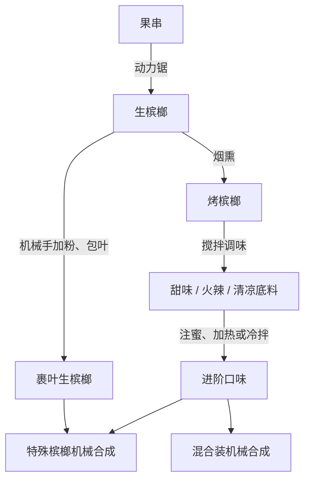

<div align="center">


<h1>槟榔 · Betel Nut Mod</h1>

<p><strong>一棵树，一条生产链，一座空岛。</strong></p>
<p>完整的槟榔生存玩法，搭配机械动力的自动化加工路线。</p>

<p>
  
  
  
  <a href="LICENSE"></a>
  <a href="https://github.com/ikunkk02-afk/Betel-Nut-Mod/actions/workflows/build.yml?query=branch%3Acodex%2Fneoforge-1.21.1"></a>
</p>

<p>
  <a href="https://github.com/ikunkk02-afk/Betel-Nut-Mod/releases/tag/neoforge-1.21.1-v5.7.1">下载</a> ·
  <a href="#快速安装">快速安装</a> ·
  <a href="#玩法一览">玩法一览</a> ·
  <a href="#机械动力生产线">机械动力</a> ·
  <a href="#文档导航">文档导航</a> ·
  <a href="#开发构建">开发构建</a>
</p>

<p>
  <a href="https://github.com/ikunkk02-afk/Betel-Nut-Mod/tree/main">← 切换到 Fabric 版</a> ·
  <strong>NeoForge 版</strong>
</p>

</div>

---

## 玩法一览

本分支将 Fabric 5.7.0 的完整玩法移植到 NeoForge，并在 **5.7.1** 重整了机械动力生产线。你可以经营槟榔种植园，用手工或厨具加工口味，也可以把采收后的果串送进自动化工厂。

| 玩法 | 你可以做什么 |
| --- | --- |
| 🌴 种植与采收 | 探索自然树群、培育四种树冠的槟榔树，收获会再生的青果串与黄果串。 |
| 🔥 加工与口味 | 营火烤制、贝壳制粉、包叶生食，逐步制作 **17 种变种槟榔**。 |
| ⚙️ 机械动力 | 用 **33 条可选配方**串联切割、研磨、烟熏、分步包叶、注液与机械合成。 |
| 🧺 交易与收藏 | 与农民、渔夫和牧师交易，收集三款品牌混合装、封签与奖券。 |
| 💚 身体状态 | 管理按世界日期累计的依赖、戒断与口腔暴露，使用 HUD 与恢复饮品。 |
| 🪵 建筑与空岛 | 使用完整槟榔木材系列，挑战两种空岛，并完成 **28 个可见进度节点**。 |

<p align="center">
  
  &nbsp;
  
  &nbsp;
  
  &nbsp;
  
  &nbsp;
  
  &nbsp;
  
</p>

## 快速安装

### 运行环境

| 项目 | 要求 |
| --- | --- |
| Minecraft | **1.21.1** |
| Java | **21** |
| NeoForge | **21.1.259 或更新的 21.1.x** |
| MidnightLib | 发布包已内嵌 **1.9.2**，无需额外安装 |
| 可选：Create | 已验证 **1.21.1-6.0.10** |
| 可选：Farmer's Delight | 已验证 **1.21.1-1.3.4** |

Create 与 Farmer's Delight 均为可选联动；本模组也能独立运行。使用 NeoForge 原生注册、事件、网络和数据存储，无需 Fabric API 或 Cardinal Components API。

### 安装步骤

1. 安装 Minecraft 1.21.1 的 NeoForge 环境。
2. 从 [NeoForge 5.7.1 发布页](https://github.com/ikunkk02-afk/Betel-Nut-Mod/releases/tag/neoforge-1.21.1-v5.7.1) 下载 `betel-nut-mod-neoforge-5.7.1.jar`，发布页也提供源码包和 SHA-256 校验文件。
3. 将安装包放入游戏实例的 `mods` 文件夹。`-sources.jar` 是供开发使用的源码包。
4. 按需安装 Minecraft 1.21.1 对应的 NeoForge 版 Create、Farmer's Delight 及它们各自的必需前置。
5. 启动游戏，在创造模式的模组物品栏中确认槟榔物品已加载；创建普通世界或选择槟榔空岛预设开始游玩。

多人游戏时，客户端与服务端都需要安装本模组。开发中的快照可从 [NeoForge 分支构建](https://github.com/ikunkk02-afk/Betel-Nut-Mod/actions/workflows/build.yml?query=branch%3Acodex%2Fneoforge-1.21.1) 获取，也可按下方说明自行构建。

> **存档说明**：Fabric 使用 `betel-nut-mod` 命名空间，NeoForge 使用 `betel_nut_mod`，两端的数据存储格式也不同。跨加载器请创建独立存档；本工程未提供 Fabric 旧世界转换器。

## 从第一串果实开始

手持剪刀右键树上的果串：青果串拆出 **3 个生果**，成熟黄果串拆出 **5 个生果**，黄果串搭配槟榔叶可制作树苗。保留完整根部、树干与树冠，在满足光照和区块加载条件时等待再次结果。

生果可以用营火烤制，也可以用贝壳粉和叶子包裹。不同口味提供短时增益与后效，三款混合装各包含六种槟榔和一张奖券，包装仍需品牌封签。

默认按 **L** 查看进度，按 **H** 编辑 HUD、悬停查看详细状态。种植、采收、交易、拆包等进度检查实际动作，收藏进度则记录曾获得的物品。

### 农夫乐事厨具联动

安装 **Farmer's Delight** 后，相关手工口味与恢复饮品配方切换到烹饪锅路线；砧板处理果串保持 3 / 5 个生果的产量，完整树叶可切出 2 片槟榔叶。瓶装恢复品需要玻璃瓶。

## 机械动力生产线

5.7.1 沿用现有物品重排机器与工序，让不同加工阶段各有分工。



| 工序 | 机器与材料 |
| --- | --- |
| 原料处理 | 动力锯切果串、原木和树叶；磨石将贝壳磨成贝壳粉。 |
| 生果包叶 | 机械手依次加入贝壳粉、槟榔叶，一轮制作一个裹叶生槟榔。 |
| 分层调味 | 从烤果制作基础口味，再用对应底料继续加工；冷热工序各有分工。 |
| 蜂蜜裹浆 | 注液器为甜味槟榔注入 **125 mB 蜂蜜**，制成蜂蜜槟榔。 |
| 稀有加工与包装 | 机械合成器仍需指定的稀有材料；混合装消耗六种口味、空包装和封签。 |
| 恢复与回收 | 加热搅拌制作瓶装恢复用品；动力压机将九个槟榔渣压成渣块。 |

原有手工配方保留；Create 自动导入的相关手工配方受到限制，使机器加工走明确的生产路线。Create 与 Farmer's Delight 可同时启用。

**[查看全部 33 条配方、材料用量与加热要求 →](docs/create-production-5.7.1.md)**

## 身体状态与空岛生存

### 身体状态

依赖和口腔暴露按**主世界日期**累计，同一天反复食用只计一次。停用后会逐步进入戒断，不同恢复物品分别处理依赖、戒断和口腔暴露。

三种无需咀嚼的恢复饮品——金苹果糨糊、附魔金苹果糨糊、缓解药剂——提供不同程度的恢复。缓解药剂每个世界日最多生效一次；进食限制与完整恢复规则见 [恢复用品说明](docs/recovery-and-food-5.2.0.md)。

> 槟榔、矿物调味、增益和病变均为游戏玩法设定，不对应现实健康建议。请勿将游戏中的加工或恢复方式用于现实生活。

### 两种空岛

| 世界预设 | 开局与发展 |
| --- | --- |
| **经典槟榔空岛** | 从小型虚空岛、开局箱子与指南书出发，建立种植、堆肥和刷石循环。 |
| **槟榔一方块空岛** | 从一个槟榔渣块起步，利用首次发放的物资扩建；中心方块不会挖掘刷新。 |

开局物资不会因重进或死亡重复发放。空岛模式提供手动堆肥、虚空救援和水中召雷仪式，帮助推进生存与末地路线。相关规则仅在对应空岛预设内启用。

## 配置与存档

| 文件或入口 | 内容 |
| --- | --- |
| `config/betel_nut.json` | 自然生成、依赖、戒断、口腔病变、交易与部分物品行为。 |
| `config/betel_nut_mod.json` | MidnightLib 管理的空岛与特殊效果配置。 |
| `config/betel_nut_mod_client.json` | 本地 HUD 显示、位置与缩放。 |
| 主世界 `data/betel_nut_mod_skyblock.dat` | 空岛生成状态与坐标。 |
| `/betel reload` / `/betel trades info` | 重载配置 / 查看交易基础报价，需要管理员权限。 |
| `/betelskyblock status` | 查看空岛状态，需要管理员权限。 |

玩家依赖与开局物资标记由 NeoForge 原生数据附件保存，死亡复制遵循原有规则。世界预设和首次开局相关配置应在创建世界前调整。

## 文档导航

| 想了解什么 | 阅读 |
| --- | --- |
| 每台机器的材料、产量与工序 | [机械动力 5.7.1 生产线](docs/create-production-5.7.1.md) |
| 加载器适配、模型与存档实现 | [NeoForge 移植记录](docs/neoforge-port-5.7.0.md) |
| 完整果串、再生与树苗来源 | [果串采收](docs/whole-bunch-harvest-5.3.0.md) |
| 原料、产量与农夫乐事加工 | [口味配方](docs/variant-processing-5.1.0.md) |
| 各种槟榔的增益与后效 | [食用效果](docs/betel-effects-5.5.0.md) |
| 饮品、病变与进食限制 | [恢复规则](docs/recovery-and-food-5.2.0.md) |
| 职业等级、报价与交易配置 | [村民交易](docs/villager-trades-5.4.0.md) |
| 开局资源、堆肥与末地路线 | [空岛生存](docs/skyblock-5.6.0.md) |
| 两个进度页与动作判定 | [进度系统](docs/advancements-5.7.0.md) |

共同玩法文档保留 Fabric 版本的历史标题；NeoForge 安装信息和机械动力配方以本页及 5.7.1 生产线文档为准。

## 开发构建

使用 **JDK 21** 与仓库自带的 Gradle Wrapper。

```sh
git clone --branch codex/neoforge-1.21.1 https://github.com/ikunkk02-afk/Betel-Nut-Mod.git betel-nut-neoforge
cd betel-nut-neoforge
./gradlew build
./gradlew runClient
```

Windows PowerShell 将 `./gradlew` 替换为 `.\gradlew.bat`。安装包输出在 `build/libs/`，MidnightLib 内嵌其中；Create 与 Farmer's Delight 由玩家按需安装。

<details>
<summary><strong>开发者：运行回归测试与客户端检查</strong></summary>

```sh
./gradlew -PportTests runGameTestServer
./gradlew -PportTests -PcreateOnly runGameTestServer
./gradlew -PportTests -PcompatMods runGameTestServer
./gradlew -PportTests -PcompatMods runPortSmoke
python -X utf8 scripts/verify-port.py
```

`-PcreateOnly` 为开发运行添加 Create；`-PcompatMods` 添加 Create 与 Farmer's Delight。重复客户端检查可用 `-PportSmokeDir=新的目录名` 指定独立运行目录。

三种依赖环境各验证 **126 项 GameTest**。当前版本的验证记录、客户端检查和产物哈希见 [verification/report.json](verification/report.json)，游戏内截图见 [截图目录](verification/screenshots)。测试与预览入口不进入发布 JAR。

</details>

反馈问题时，请附上 Minecraft、NeoForge 与模组版本、联动模组列表、复现步骤和相关日志：[提交 Issue](https://github.com/ikunkk02-afk/Betel-Nut-Mod/issues)。

---

<div align="center">

**作者：寿云** · [Bilibili](https://space.bilibili.com/1832031043) · [GitHub](https://github.com/ikunkk02-afk/Betel-Nut-Mod)

[MIT License](LICENSE) · 包装为游戏同人设计，与对应品牌无合作关系。

</div>
