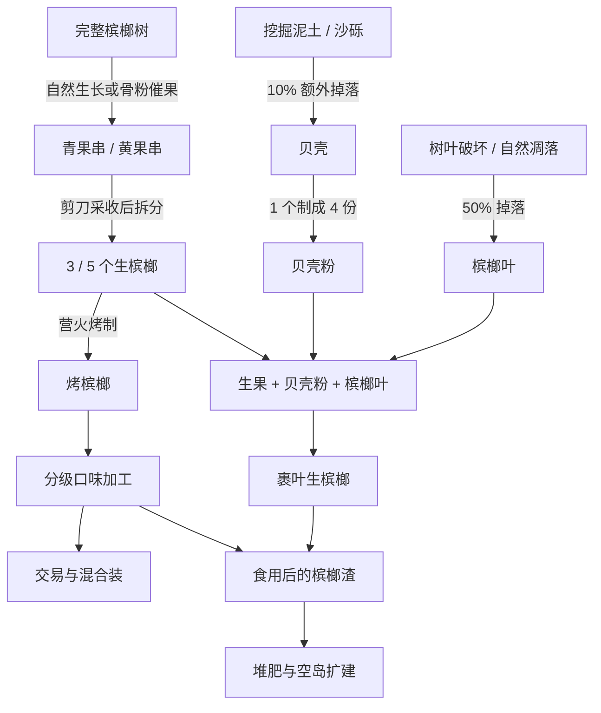

<div align="center">


<h1>槟榔 · Betel Nut Mod</h1>

<p><strong>一棵树，一条生产链，一座空岛。</strong></p>
<p>为 Minecraft 生存加入槟榔种植、口味加工、村民交易与身体状态管理。</p>

<p>
  
  
  
  <a href="LICENSE"></a>
  <a href="https://github.com/ikunkk02-afk/Betel-Nut-Mod/actions/workflows/build.yml?query=branch%3Amain"></a>
</p>

<p>
  <a href="https://github.com/ikunkk02-afk/Betel-Nut-Mod/releases/tag/fabric-1.21.1-v5.7.0">下载</a> ·
  <a href="#快速安装">快速安装</a> ·
  <a href="#玩法一览">玩法一览</a> ·
  <a href="#空岛生存">空岛生存</a> ·
  <a href="#文档导航">文档导航</a> ·
  <a href="#开发构建">开发构建</a>
</p>

<p>
  <strong>Fabric 版</strong> ·
  <a href="https://github.com/ikunkk02-afk/Betel-Nut-Mod/tree/codex/neoforge-1.21.1">切换到 NeoForge 版 →</a>
</p>

</div>

---

当前源码 **5.8.1** 补齐创造模式食用槟榔返还槟榔渣；全部 19 种可食用槟榔每次吃完都会获得 1 个渣，背包满时掉落。槟榔与槟榔渣的物品提示已注明获取方式。5.8.0 的概率贝壳掉落、砍树回收和骨粉催果继续保留；下方发布页链接对应已发布的 5.7.0。

更新规则见 [原料与骨粉催果 5.8.0](docs/production-5.8.0.md)。

## 玩法一览

在丛林中寻找槟榔树，用剪刀收下完整果串，再把生果加工成不同口味。你可以经营种植园、收集木材与混合装，也可以从虚空中的小岛开始，建立自己的生存循环。

| 玩法 | 你可以做什么 |
| --- | --- |
| 🌴 种植与采收 | 探索自然树群、培育四种树冠的槟榔树，收获会再生的青果串与黄果串。 |
| 🔥 加工与口味 | 营火烤制、贝壳制粉、包叶生食，逐步制作 **17 种变种槟榔**。 |
| 🧺 交易与收藏 | 与农民、渔夫和牧师交易，收集三款品牌混合装、封签与奖券。 |
| 🪵 建筑与红石 | 使用槟榔木板、楼梯、台阶、栅栏、门、活板门、按钮与压力板。 |
| 💚 身体状态 | 管理按世界日期累计的依赖、戒断与口腔暴露，通过 HUD 和恢复饮品照顾角色。 |
| ☁️ 空岛与进度 | 挑战两种空岛预设，完成两个进度页中的 **28 个可见节点**。 |

<p align="center">
  
  &nbsp;
  
  &nbsp;
  
  &nbsp;
  
  &nbsp;
  
  &nbsp;
  
</p>

## 快速安装

### 运行环境

| 项目 | 要求 |
| --- | --- |
| Minecraft | **1.21.1** |
| Java | **21 或更高版本** |
| Fabric Loader | **0.16.0 或更新版本** |
| Fabric API | **0.116.11+1.21.1 或更新的 1.21.1 版本** |
| Cardinal Components API | **6.1.3 ≤ 版本 < 7.0.0**，包含 base、entity、world 组件 |
| MidnightLib | 发布包已内嵌 **1.9.2**，无需额外安装 |
| 可选联动 | **Farmer's Delight Refabricated**，联动测试使用 1.21.1-3.3.6 |

### 安装步骤

1. 安装 Minecraft 1.21.1 的 Fabric 环境，并准备表中的 Fabric API 与 Cardinal Components API。
2. 从 [Fabric 5.7.0 发布页](https://github.com/ikunkk02-afk/Betel-Nut-Mod/releases/tag/fabric-1.21.1-v5.7.0) 下载 `betel-nut-mod-5.7.0.jar`，发布页也提供源码包和 SHA-256 校验文件。
3. 将安装包与必需前置一起放入游戏实例的 `mods` 文件夹。`-sources.jar` 是供开发使用的源码包。
4. 如需厨具加工，再安装 Minecraft 1.21.1 对应的 Farmer's Delight Refabricated。
5. 启动游戏，在创造模式的模组物品栏中确认能找到槟榔树苗、果串与各类槟榔。

多人游戏时，客户端与服务端都需要安装本模组和必需前置。[Releases](https://github.com/ikunkk02-afk/Betel-Nut-Mod/releases) 提供按版本保存的安装包；开发中的快照可从 [Fabric 分支构建](https://github.com/ikunkk02-afk/Betel-Nut-Mod/actions/workflows/build.yml?query=branch%3Amain) 获取，也可以按下方说明自行构建。

## 从第一串果实开始



- **寻找树群**：疏林丛林中较常见，普通丛林、竹林与邻近丛林的河岸高地也有机会出现。自然生成调整只影响新生成的区块。
- **采果与育苗**：手持剪刀右键果串，青果串拆出 **3 个生果**，成熟黄果串拆出 **5 个生果**。砍掉挂果的支撑树干也会掉落对应完整果串；每块绿色冠轴原木额外掉落 **1 棵树苗**，黄果串 + 槟榔叶也可合成树苗。
- **骨粉催果**：保留根部土壤、连续树干、绿色冠轴和树冠，对任意一段竖直树干使用 **1 个骨粉**，立即催熟现有青果串并补齐最多 **3 串黄果串**。也可直接对青果串用骨粉一次催熟，支持发射器。新果串及其下方要留空；满成熟果、断干或空间堵塞时不消耗骨粉。自然结果仍需光照与区块加载。
- **收集叶子**：普通破坏或自然凋落的树叶有 **50%** 概率掉落 **1 片槟榔叶**，不掉生槟榔或果串；剪刀、精准采集可收集完整树叶。
- **获取贝壳**：挖掘泥土或沙砾有 **10%** 概率额外掉落 **1 个普通贝壳**，原有材料掉落保留；渔夫交易与钓鱼路线继续可用。**远古贝壳仍从古城宝箱获取**。
- **查看目标**：默认按 **L** 打开进度界面。收藏节点记录曾获得的物品，采收、种植、交易、拆包等节点要求实际完成动作。

| 制作步骤 | 投入 | 产出 |
| --- | --- | --- |
| 拆分青果串 / 黄果串 | 1 串完整果串 | 3 / 5 个生槟榔 |
| 贝壳制粉 | 1 个贝壳 | 4 份贝壳粉 |
| 包叶生食 | 1 个生槟榔 + 1 份贝壳粉 + 1 片槟榔叶 | 1 个裹叶生槟榔 |
| 营火烤制 | 1 个生槟榔 | 1 个烤槟榔，30 秒 |
| 育苗 | 1 串成熟黄果串 + 1 片槟榔叶 | 1 棵槟榔树苗 |

从烤槟榔继续制作甜味、火辣、清凉等基础口味，再加工进阶与综合口味；具体原料见下方口味配方文档。

### 农夫乐事厨具联动

安装 **Farmer's Delight Refabricated** 后，17 种变种槟榔和恢复饮品切换到对应的烹饪锅路线，材料与产量按联动配方保留；砧板可处理果串和完整树叶。

锅内同类槟榔需要分开放入原料槽。普通槟榔成品无需纸或碗，恢复饮品需要玻璃瓶。完整配方见 [口味加工表](docs/variant-processing-5.1.0.md) 与 [恢复用品说明](docs/recovery-and-food-5.2.0.md)。

机械动力的 **35 条兼容配方**位于 [NeoForge 分支](https://github.com/ikunkk02-afk/Betel-Nut-Mod/tree/codex/neoforge-1.21.1)，包含泥土／沙砾水洗分离贝壳路线。该路线见 [NeoForge 5.8.0 原料与催果说明](https://github.com/ikunkk02-afk/Betel-Nut-Mod/blob/codex/neoforge-1.21.1/docs/production-5.8.0.md)。

## 身体状态与恢复

依赖和口腔暴露按**主世界日期**累计，同一天反复食用只计一次。短时增益、长期依赖与停用后的戒断分别结算，角色可能逐步出现属性惩罚和进食限制。

默认 **H** 键打开 HUD 编辑界面：拖动调整位置，悬停查看详细状态。普通金苹果、附魔金苹果、牛奶与三种恢复饮品各有不同作用；已有严重进食限制时，可以使用无需咀嚼的恢复饮品。

| 恢复饮品 | 用途 |
| --- | --- |
| 金苹果糨糊 | 降低依赖与当前戒断，保留金苹果的增益。 |
| 附魔金苹果糨糊 | 降低依赖与口腔暴露，清除当前戒断并提供保护时间。 |
| 缓解药剂 | 每个世界日一次的渐进恢复，降低依赖与口腔暴露。 |

默认口腔病变阈值为累计食用 **3 / 5 / 7 个世界日**。停用、喝牛奶和治疗物品的作用不同，详细进食规则见 [恢复与进食说明](docs/recovery-and-food-5.2.0.md)。

> 槟榔、矿物调味、增益和病变均为游戏玩法设定，不对应现实健康建议。请勿将游戏中的加工或恢复方式用于现实生活。

## 空岛生存

创建世界时选择对应的世界预设，即可开始空岛模式。

| 世界预设 | 开局与发展 |
| --- | --- |
| **经典槟榔空岛** | 从小型虚空岛、开局箱子和指南书出发，发展种植、堆肥与刷石循环。 |
| **槟榔一方块空岛** | 从一个槟榔渣块起步，利用首次发放的物资扩建；中心方块不会挖掘刷新。 |

开局提供剪刀、树苗、水与熔岩、基础农作物和恢复用品等有限资源，重新登录或死亡不会重复领取。空岛内可手动堆肥获取骨粉，利用槟榔渣块扩建，并通过水中召雷仪式推进末地路线。

空岛专属规则只在对应预设内启用。完整开局物资、可再生资源和末地路线见 [空岛生存指南](docs/skyblock-5.6.0.md)。

## 配置与常用操作

| 入口 | 内容 |
| --- | --- |
| `config/betel_nut.json` | 自然生成、依赖、戒断、口腔病变、交易与部分物品行为。 |
| `config/betel-nut-mod.json` | MidnightLib 管理的空岛与特殊效果配置。 |
| `config/betel_nut_mod_client.json` | 本地 HUD 显示、位置与缩放。 |
| **H** / **L** | 编辑 HUD / 查看进度。 |
| `/betel reload` | 重载玩法配置；需要管理员权限。 |
| `/betel trades info` | 查看交易基础报价；需要管理员权限。 |
| `/betelskyblock status` | 查看空岛状态；需要管理员权限。 |

世界预设和首次开局相关配置应在创建世界前调整；部分设置需要重启生效。

## 文档导航

| 想了解什么 | 阅读 |
| --- | --- |
| 贝壳来源、砍树掉落与骨粉催果 | [5.8.0 原料生产](docs/production-5.8.0.md) |
| 完整果串、再生与树苗来源 | [果串采收](docs/whole-bunch-harvest-5.3.0.md) |
| 原料、产量与农夫乐事锅内加工 | [口味配方](docs/variant-processing-5.1.0.md) |
| 各种槟榔的增益与后效 | [食用效果](docs/betel-effects-5.5.0.md) |
| 饮品、病变与进食限制 | [恢复规则](docs/recovery-and-food-5.2.0.md) |
| 职业等级、报价与交易配置 | [村民交易](docs/villager-trades-5.4.0.md) |
| 开局资源、堆肥与末地路线 | [空岛生存](docs/skyblock-5.6.0.md) |
| 两个进度页与动作判定 | [进度系统](docs/advancements-5.7.0.md) |
| 历代版本变化 | [更新日志](CHANGELOG.md) |

## 开发构建

使用仓库自带的 Gradle Wrapper。当前 Fabric CI 使用 **JDK 25** 构建，编译目标为 Java 21。

```sh
git clone --branch main https://github.com/ikunkk02-afk/Betel-Nut-Mod.git betel-nut-fabric
cd betel-nut-fabric
./gradlew build
./gradlew checkSkyblockPersistence
./gradlew runClient
```

Windows PowerShell 将 `./gradlew` 替换为 `.\gradlew.bat`。安装包输出在 `build/libs/`。`checkSkyblockPersistence` 用于静态检查空岛保存字段和重复生成等约束，实际玩法测试源码位于 `src/gametest`。

反馈问题时，请附上 Minecraft、加载器与模组版本、联动模组列表、复现步骤和相关日志：[提交 Issue](https://github.com/ikunkk02-afk/Betel-Nut-Mod/issues)。

---

<div align="center">

**作者：寿云** · [Bilibili](https://space.bilibili.com/1832031043) · [GitHub](https://github.com/ikunkk02-afk/Betel-Nut-Mod)

[MIT License](LICENSE) · 包装为游戏同人设计，与对应品牌无合作关系。

</div>
