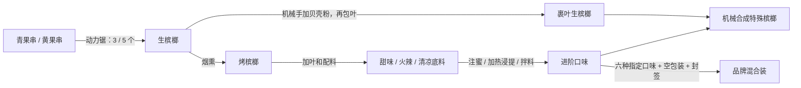

# 机械动力生产线 5.7.1

在 NeoForge 5.7.0 的基础上重整整套 Create 路线，沿用现有物品，共 33 条配方。原版手工与 Farmer’s Delight 配方、物品 ID、进度 ID、食物效果和存档结构保持原样。

## 工序分工

加热只要求正常燃烧的烈焰人燃烧室，不要求超级加热。冷拌配方不要求加热；叶子只在生果包叶或烤果初次调味时加入，已调味的底料不反复加叶。

## 主要调整

- 机械手按“贝壳粉 → 槟榔叶”的顺序包叶，一轮完成 1 个裹叶生槟榔。无需新注册中间物品。
- 甜味和火辣从烤果开始，清凉保留海晶碎片／海晶砂粒两种路线；配液每批用 250 mB 水。
- 蜂蜜改为给甜味槟榔裹浆，每个用 125 mB 蜂蜜，两个用量等于一瓶蜂蜜的 250 mB，不凭空返还玻璃瓶。
- 夜行从清凉底料加工；提神、石英、青金石从甜味底料加工；紫水晶从蜂蜜底料加工；岩浆从火辣底料加工。
- 发光、幻翼从夜行底料冷拌；末影、回响及三个综合口味改用机械合成器，仍需末影珍珠、远古贝壳、回响碎片等指定材料。
- 空包装和三款混合装支持机械合成，混合装仍消耗六种指定口味、空包装与品牌封签。
- 三种瓶装恢复用品支持加热搅拌，必须提供玻璃瓶、蜂蜜及对应金苹果／附魔金苹果等材料。
- 增加树叶切割路线，完整树叶产 2 片槟榔叶；果串、原木、贝壳与槟榔渣压块保持原产量。

## 完整配方表

| 机器 | 投入 | 产出 | 条件 |
| --- | --- | --- | --- |
| 机械手顺序装配 | 1 × 生槟榔 + 1 × 贝壳粉 + 1 × 槟榔叶 | 1 × 裹叶生槟榔 | 依次加粉、包叶；1 轮 |
| 动力压机 + 盆 | 9 × 槟榔渣 | 1 × 槟榔渣块 | 无需加热 |
| 动力锯 | 1 × 槟榔树叶 | 2 × 槟榔叶 | 40 tick |
| 动力锯 | 1 × 槟榔树原木 | 6 × 槟榔木板 | 100 tick |
| 动力锯 | 1 × 成熟槟榔果串 | 5 × 生槟榔 | 80 tick |
| 动力锯 | 1 × 未成熟槟榔果串 | 3 × 生槟榔 | 80 tick |
| 注液器 | 1 × 甜味槟榔 + 125 mB 蜂蜜 | 1 × 蜂蜜槟榔 | 无需加热 |
| 机械合成器 | 2 × 裹叶生槟榔 + 1 × 远古贝壳 + 1 × 回响碎片 | 2 × 回响槟榔 | 按配方图案排列 |
| 机械合成器 | 2 × 纸 + 1 × 线 | 2 × 空槟榔包装 | 按配方图案排列 |
| 机械合成器 | 2 × 夜行槟榔 + 1 × 末影珍珠 + 1 × 紫颂果 | 2 × 末影槟榔 | 按配方图案排列 |
| 机械合成器 | 1 × 烤槟榔 + 1 × 蜂蜜槟榔 + 1 × 石英槟榔 + 1 × 紫水晶槟榔 + 1 × 青金石槟榔 + 1 × 幻翼槟榔 + 1 × 空槟榔包装 + 1 × 品牌封签 | 1 × 和成天下混合装 | 按配方图案排列 |
| 机械合成器 | 1 × 烤槟榔 + 1 × 火辣槟榔 + 1 × 甜味槟榔 + 1 × 清凉槟榔 + 1 × 夜行槟榔 + 1 × 提神槟榔 + 1 × 空槟榔包装 + 1 × 品牌封签 | 1 × 口味王混合装 | 按配方图案排列 |
| 机械合成器 | 1 × 甜味槟榔 + 1 × 夜行槟榔 + 1 × 紫水晶槟榔 + 1 × 绿宝石 + 1 × 发光浆果 | 3 × 琳琅天下槟榔 | 按配方图案排列 |
| 机械合成器 | 1 × 提神槟榔 + 1 × 石英槟榔 + 1 × 紫水晶槟榔 + 1 × 金苹果 | 3 × 合成天下槟榔 | 按配方图案排列 |
| 机械合成器 | 1 × 夜行槟榔 + 1 × 石英槟榔 + 1 × 紫水晶槟榔 + 1 × 回响碎片 | 3 × 地下槟榔 | 按配方图案排列 |
| 机械合成器 | 1 × 烤槟榔 + 1 × 蜂蜜槟榔 + 1 × 甜味槟榔 + 1 × 清凉槟榔 + 1 × 夜行槟榔 + 1 × 火辣槟榔 + 1 × 空槟榔包装 + 1 × 品牌封签 | 1 × 湘潭铺子混合装 | 按配方图案排列 |
| 磨石 | 1 × 贝壳 | 4 × 贝壳粉 | 100 tick |
| 动力搅拌器 + 盆 | 2 × 蜂蜜槟榔 + 1 × 紫水晶碎片 + 250 mB 水 | 2 × 紫水晶槟榔 | 加热 |
| 动力搅拌器 + 盆 | 1 × 附魔金苹果 + 1 × 玻璃瓶 + 250 mB 蜂蜜 | 1 × 附魔金苹果糨糊 | 加热 |
| 动力搅拌器 + 盆 | 2 × 甜味槟榔 + 1 × 红石粉 + 1 × 可可豆 + 250 mB 水 | 2 × 提神槟榔 | 加热 |
| 动力搅拌器 + 盆 | 2 × 夜行槟榔 + 1 × 发光浆果 + 1 × 荧石粉 | 2 × 荧光槟榔 | 无需加热 |
| 动力搅拌器 + 盆 | 1 × 金苹果 + 1 × 玻璃瓶 + 250 mB 蜂蜜 | 1 × 金苹果糨糊 | 加热 |
| 动力搅拌器 + 盆 | 2 × 甜味槟榔 + 1 × 青金石 + 1 × 兔子脚 + 250 mB 水 | 2 × 青金石槟榔 | 加热 |
| 动力搅拌器 + 盆 | 2 × 火辣槟榔 + 1 × 岩浆膏 + 1 × 烈焰粉 | 2 × 岩浆槟榔 | 加热 |
| 动力搅拌器 + 盆 | 2 × 清凉槟榔 + 1 × 金胡萝卜 + 250 mB 水 | 2 × 夜行槟榔 | 加热 |
| 动力搅拌器 + 盆 | 2 × 夜行槟榔 + 1 × 幻翼膜 + 1 × 糖 | 2 × 幻翼槟榔 | 无需加热 |
| 动力搅拌器 + 盆 | 2 × 甜味槟榔 + 1 × 下界石英 + 250 mB 水 | 2 × 石英槟榔 | 加热 |
| 动力搅拌器 + 盆 | 2 × 烤槟榔 + 1 × 槟榔叶 + 1 × 海晶砂粒 + 1 × 海带 + 250 mB 水 | 2 × 清凉槟榔 | 无需加热 |
| 动力搅拌器 + 盆 | 2 × 烤槟榔 + 1 × 槟榔叶 + 1 × 海晶碎片 + 1 × 海带 + 250 mB 水 | 2 × 清凉槟榔 | 无需加热 |
| 动力搅拌器 + 盆 | 1 × 蒲公英 + 1 × 糖 + 1 × 玻璃瓶 + 250 mB 蜂蜜 | 1 × 缓解药剂 | 加热 |
| 动力搅拌器 + 盆 | 2 × 烤槟榔 + 1 × 槟榔叶 + 1 × 烈焰粉 + 1 × 甜浆果 + 250 mB 水 | 2 × 火辣槟榔 | 加热 |
| 动力搅拌器 + 盆 | 2 × 烤槟榔 + 1 × 槟榔叶 + 1 × 糖 + 250 mB 水 | 2 × 甜味槟榔 | 加热 |
| 烟熏炉／烟熏鼓风机 | 1 × 生槟榔 | 1 × 烤槟榔 | 烟熏炉 600 tick；鼓风机用 Create 自身处理时间 |

## 自动化防绕过

Create 会自动把部分原版合成配方转换为机器配方。这里仅阻止其自动转换本模组的 26 个相关手工配方 ID，使它们在 Create 内走显式生产线。原手工配方和 ID 继续存在；原木、建筑材料、其他模组及原版普通配方不受这条规则影响。未安装 Create 时该可选适配不会加载。

## 验证

验证原模组回归，并新增真实盆处理、热量与流体不足、底料阶段、注液器蜂蜜用量、顺序装配、机械合成封签与稀有材料、自动配方防绕过检查。无 Create、仅 Create、Create + Farmer’s Delight 分别运行测试。实际日志见 `verification/create-5.7.1`。

5.7.0 安装包与修订前的配方备份保留；升级到 5.7.1 后，既有物品、树、建筑及玩家状态继续沿用。机械动力工厂应按新配方调整投入与机器分工。
